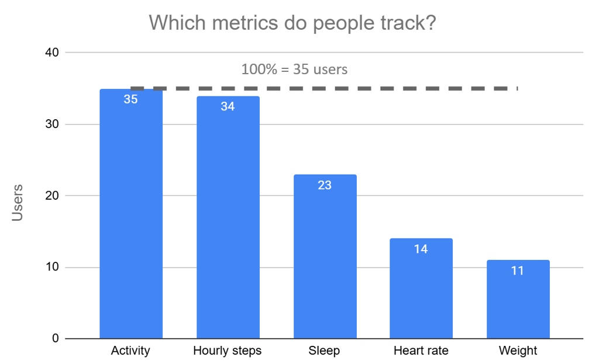
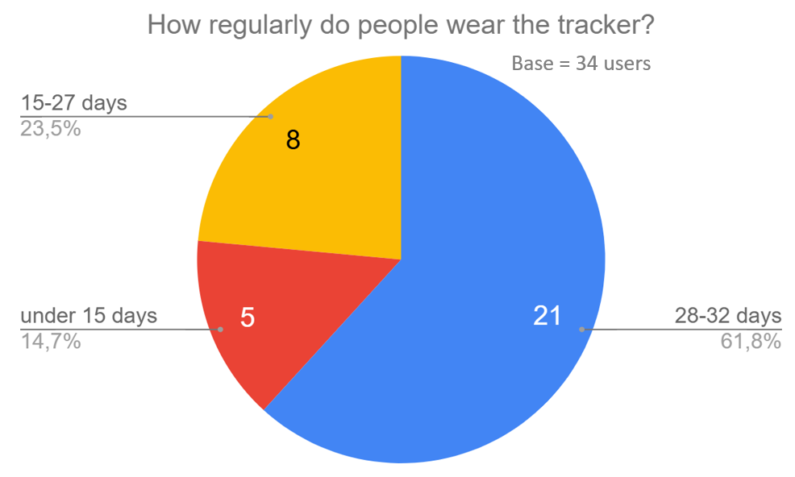
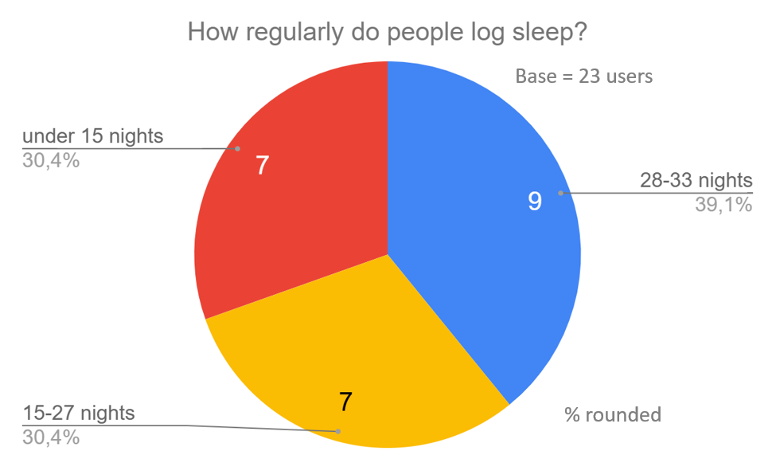

# Analysis

Three questions are answered here; the queries use the cleaned tables (see `data_checks.md`).

## Finding 1: which metrics do people track?

How many of the 35 users appear in each table:

```sql
SELECT
  (SELECT COUNT(DISTINCT Id) FROM `Bellabeat_study.dailyActivity_merged`) AS activity,
  (SELECT COUNT(DISTINCT Id) FROM `Bellabeat_study.hourlySteps_clean`) AS hourly_steps,
  (SELECT COUNT(DISTINCT Id) FROM `Bellabeat_study.minuteSleep_clean_parse`) AS sleep,
  (SELECT COUNT(DISTINCT Id) FROM `Bellabeat_study.heartrate_seconds_clean`) AS heart_rate,
  (SELECT COUNT(DISTINCT Id) FROM `Bellabeat_study.weightLogInfo_clean`) AS weight
```

**Result:**

| Metric | Users | Share of 35 |
|---|---|---|
| Activity | 35 | 100% |
| Hourly steps / calories / intensity | 34 | 97% |
| Sleep | 23 | 66% |
| Heart rate | 14 | 40% |
| Weight | 11 | 31% |

**Takeaway:** All 35 users track activity, but only two thirds track sleep, 40% heart rate and under a third weight. Activity is the core feature people use; the others reach far fewer users.



## Finding 2: how regularly do people wear the tracker?

A "worn day" is a day with more than zero steps in the hourly data (zero-step days are treated as the tracker not being worn). Hourly tables are used because `dailyActivity` contains only 457 of the 1,021 user-days they cover (see `data_checks.md`, section 6). The period is 32 days.

Worn days per user:

```sql
SELECT
  Id,
  COUNT(*) AS days_worn
FROM (
  SELECT Id, DATE(activity_hour) AS day
  FROM `Bellabeat_study.hourlySteps_clean`
  GROUP BY Id, day
  HAVING SUM(StepTotal) > 0
)
GROUP BY Id
ORDER BY days_worn DESC
```

Users grouped by how many days they wore the tracker:

```sql
SELECT
  CASE
    WHEN days_worn >= 28 THEN '28-32 days'
    WHEN days_worn >= 15 THEN '15-27 days'
    ELSE 'under 15 days'
  END AS usage_group,
  COUNT(*) AS users
FROM (
  SELECT Id, COUNT(*) AS days_worn
  FROM (
    SELECT Id, DATE(activity_hour) AS day
    FROM `Bellabeat_study.hourlySteps_clean`
    GROUP BY Id, day
    HAVING SUM(StepTotal) > 0
  )
  GROUP BY Id
)
GROUP BY usage_group
```

**Result** (34 users in the hourly tables):

| Days worn | Users | Share |
|---|---|---|
| 28-32 days | 21 | 62% |
| 15-27 days | 8 | 24% |
| under 15 days | 5 | 14% |

**Takeaway:** the majority of users (21 of 34, 62%) wore the tracker on 28–32 of the 32 days, so most people use it almost daily. 8 users (24%) wore it 15–27 days, and 5 users (14%) fewer than 15 days.



## Also checked: activity by hour of day

Average steps per hour of the day across all users, to see whether reminders at specific hours would make sense.

```sql
SELECT
  EXTRACT(HOUR FROM activity_hour) AS hour_of_day,
  ROUND(AVG(StepTotal)) AS avg_steps
FROM `Bellabeat_study.hourlySteps_clean`
GROUP BY hour_of_day
ORDER BY hour_of_day
```
**Result:** activity is close to zero at night (1–5h), rises from 6h, and stays at roughly 390–530 steps per hour between 9h and 19h, with peaks at 12h (521) and 19h (529). The lowest daytime hour is 15h (390).

**Takeaway:** Takeaway: daytime activity is fairly even across all users (about 390–530 steps per hour between 9h and 19h), and the data does not show a clear inactive period. The profession of the users is unknown, so no conclusion about sedentary work is drawn. Reminders at specific hours are not recommended based on this check.

## Finding 3: how regularly do people log sleep?

Sleep is recorded minute by minute; a night is counted as a calendar date with at least one sleep record, so counts are approximate (the sleep data starts one day before the activity data).

Nights logged per user:

```sql
SELECT 
Id,
COUNT (DISTINCT (DATE(date))) AS night_logged
FROM `Bellabeat_study.minuteSleep_clean_parse` 
GROUP BY Id
ORDER BY night_logged
```

Users grouped by nights logged:

```sql
SELECT
CASE
WHEN night_logged>=28 THEN '28-33 night_logged'
WHEN night_logged>=15 THEN '15-27 night_logged'
ELSE 'less 15 night_logged'
END AS sleep_group,
COUNT(*) AS users
FROM
(SELECT 
Id,
COUNT (DISTINCT (DATE(date))) AS night_logged
FROM `Bellabeat_study.minuteSleep_clean_parse` 
GROUP BY Id
ORDER BY night_logged)
GROUP BY sleep_group
```

**Result:**

| Nights logged | Users | Share of 23 |
|---|---|---|
| 28–33 | 9 | 40% |
| 15–27 | 7 | 30% |
| under 15 | 7 | 30% |

**Takeaway:** 23 of 35 users logged sleep at all. Among them 9 (40%) logged 28–33 nights, 7 (30%) logged 15–27 nights and 7 (30%) fewer than 15. Counted over all 35 users, only 9 (26%) logged sleep almost every night, versus 62% who wore the tracker almost every day.


